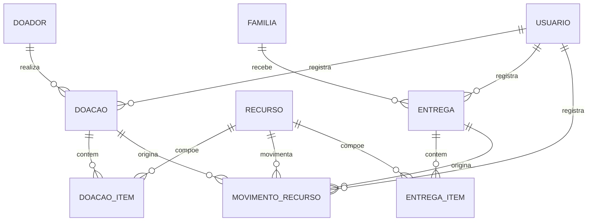

# Etapa 2 — Problema, escopo e planejamento do MVP

> **Status:** proposta para aprovação. Nenhuma implementação deve começar antes da revisão desta etapa.
>
> **Projeto:** Desafio 3 — Tecnologia para o Impacto Social
> **Organização de referência:** KODIE (organização do curso)
> **Data:** 19/10/2026

---

## 1. Problema e situação atual

### 1.1 Premissa

A KODIE é a organização do curso. Até o momento, não há um processo operacional real documentado por ela. O problema descrito abaixo é um **cenário hipotético inspirado em situações plausíveis** de iniciativas de impacto social. Se houver um processo real, este documento deve ser ajustado antes da implementação.

### 1.2 Situação atual

Em muitas iniciativas sociais, doações e distribuições são controladas de forma fragmentada:

- doações chegam por WhatsApp, telefone, caderno e conversas informais;
- não existe um registro único de entrada, saldo, validade e destino;
- entregas são anotadas em papel ou em planilhas separadas;
- a equipe não consegue responder rapidamente: “temos?”, “quanto?”, “vence quando?”, “para quem foi?”;
- itens ficam esquecidos, vencem ou são distribuídos em duplicidade;
- a prestação de contas aos doadores é manual.

### 1.3 Consequências

- perda de recursos e de alimentos;
- retrabalho e tempo gasto em conferência;
- risco de negar um item que existe ou de entregar o mesmo item duas vezes;
- falta de transparência para doadores e para a própria equipe;
- dificuldade de planejar compras, reposições e campanhas.

### 1.4 O que o MVP não tenta resolver

O MVP não pretende resolver todos os problemas da organização. Ele ataca o núcleo operacional: **registrar a doação, manter o saldo confiável e registrar a entrega, com rastreabilidade**.

---

## 2. Público afetado e usuários da aplicação

| Grupo | Relação com o problema | Necessidade principal |
|---|---|---|
| Famílias atendidas | Recebem os recursos; são afetadas por atrasos, perdas e entregas duplicadas | Receber o recurso certo, no tempo certo |
| Doadores | Doam recursos e querem saber se a doação chegou ao destino | Transparência e prestação de contas |
| Coordenação | Valida doações, acompanha estoque, autoriza ajustes | Visão consolidada e controle |
| Voluntários de estoque | Recebem, conferem e organizam as doações | Registro rápido e simples |
| Voluntários de entrega | Entregam recursos às famílias | Consulta de saldo e registro da entrega |

### Perfis funcionais

- **Coordenação:** valida doações, consulta tudo, realiza ajustes de estoque, cancela registros.
- **Voluntário:** registra doações e entregas, consulta saldo e histórico.

A implementação de login e permissões depende da ferramenta escolhida na Etapa 3. Se a ferramenta não oferecer autenticação, o MVP usará um campo “responsável” e documentará a limitação.

---

## 3. Solução proposta e benefício esperado

### 3.1 Solução

Uma aplicação low-code com:

- catálogo de **recursos** (bens e, futuramente, serviços);
- cadastro de doadores;
- registro de doações com vários itens;
- controle de saldo por meio de um **livro de movimentos** (entradas, saídas e ajustes);
- cadastro de famílias por código;
- registro de entregas;
- workflow de validação da doação e confirmação da entrega;
- painel de acompanhamento com saldo, alertas e histórico.

### 3.2 Modelo agnóstico de recurso

O catálogo **não é fixo por tipo de item**. A entidade `recurso` aceita dois tipos:

- **`bem`:** recurso físico com quantidade, unidade, saldo e, opcionalmente, validade. Exemplos: arroz, roupa, livro, tablet, cesta básica.
- **`serviço`:** recurso intangível com capacidade, duração ou número de atendimentos. Exemplos: hora de reforço escolar, consulta odontológica, orientação jurídica, corte de cabelo.

O MVP implementa o fluxo operacional de **bens**. O modelo já nasce preparado para serviços, que serão ativados na v2. A organização poderá cadastrar qualquer recurso que faça sentido para sua operação, sem depender de categorias fixas no código.

**Doações financeiras ficam fora do escopo.** Dinheiro exige controle de fundos, recibos, conciliação e prestação de contas contábil; misturar isso com bens e serviços aumentaria muito o escopo e os riscos do MVP.

### 3.3 Benefício esperado

- visibilidade confiável do saldo;
- rastreabilidade doação → movimento → entrega;
- menos retrabalho e menos perda de itens;
- base para o fluxo de solicitações e triagem da v2;
- prestação de contas mais simples.

Não serão inventadas métricas de impacto. Os benefícios acima são **esperados**; o que será efetivamente validado são os fluxos e os registros do MVP.

---

## 4. Escopo do MVP (v1)

### 4.1 Dentro do escopo

- cadastro de recursos do tipo `bem`;
- cadastro de doadores;
- registro de doações com múltiplos itens;
- validação da doação pela coordenação;
- entrada automática no saldo após a validação;
- cadastro de famílias por código;
- registro de entregas com múltiplos itens;
- baixa automática no saldo após a confirmação da entrega;
- ajuste manual de saldo com motivo obrigatório;
- cancelamento com movimento compensatório, sem apagar histórico;
- painel com saldo, alertas e movimentos recentes;
- listas com filtros e histórico;
- validações de campos, quantidades, datas, saldo e duplicidade.

### 4.2 Fora do escopo do MVP

- solicitações de ajuda e triagem (v2);
- prioridade, prazo e SLA de atendimento (v2);
- fluxo operacional de serviços (v2);
- doações financeiras;
- integração com WhatsApp, e-mail ou SMS;
- cadastro completo de beneficiários (nome, endereço, telefone);
- aplicativo móvel nativo;
- relatórios exportáveis complexos;
- autenticação avançada e permissões granulares, se a ferramenta não oferecer;
- controle de múltiplas unidades ou conversão entre unidades;
- controle de lotes e rastreamento FEFO/FIFO;
- notificações externas.

### 4.3 Evolução prevista para a v2

- cadastro de solicitações de ajuda;
- itens solicitados por recurso;
- regra automática de prioridade;
- atribuição de responsável;
- status do atendimento e alerta de atraso;
- vínculo entre entrega e solicitação;
- fluxo de serviços: reserva de capacidade, agendamento, realização e consumo;
- painel de solicitações abertas, prioridade, atraso e atendimento.

A v2 será **aditiva**: novas tabelas e, no máximo, uma chave estrangeira anulável em `entrega`. Os dados da v1 não serão reescritos.

---

## 5. Funcionalidades e requisitos do desafio

| Funcionalidade | Requisito atendido | Como contribui para o problema |
|---|---|---|
| Cadastro de recursos | Formulário e banco de dados | Padroniza o catálogo e permite qualquer tipo de bem |
| Cadastro de doadores | Formulário e banco de dados | Identifica a origem e permite prestação de contas |
| Registro de doações | Formulário, banco e workflow | Registra a entrada e dispara a validação |
| Validação da doação | Workflow | Evita entrada de dados incompletos no saldo |
| Livro de movimentos | Banco e workflow | Mantém o saldo rastreável e auditável |
| Registro de entregas | Formulário, banco e workflow | Registra a saída e o destino |
| Baixa automática de saldo | Workflow | Impede entrega acima do disponível |
| Ajuste de saldo | Workflow e acompanhamento | Corrige divergências com justificativa |
| Painel | Acompanhamento | Dá visão rápida do estoque e dos alertas |
| Listas e filtros | Acompanhamento | Permite consultar doações, saldo e entregas |
| Histórico | Acompanhamento | Mostra o que aconteceu, quando e por quem |
| Modelo de recurso genérico | Banco de dados | Prepara bens e serviços sem reescrever o catálogo |

---

## 6. Telas e navegação

### 6.1 Estrutura de navegação

```
Visão geral
  └── Dashboard

Cadastros
  ├── Recursos
  ├── Doadores
  └── Famílias

Operação
  ├── Doações
  ├── Entregas
  └── Estoque

Acompanhamento
  └── Histórico
```

### 6.2 Telas

| Tela | Objetivo | Elementos principais |
|---|---|---|
| Dashboard | Visão rápida da operação | Cards de alertas, saldo por recurso, últimas doações e entregas |
| Recursos — lista | Consultar o catálogo | Busca, filtro por tipo/categoria/status, botão “Novo recurso” |
| Recursos — formulário | Criar/editar recurso | Nome, tipo, unidade, categoria, estoque mínimo, ativo |
| Doadores — lista | Consultar doadores | Busca, botão “Novo doador” |
| Doadores — formulário | Criar/editar doador | Nome, tipo, contato, observações |
| Doações — lista | Acompanhar doações | Filtros por status, doador e data; botão “Nova doação” |
| Doações — formulário | Registrar doação | Doador, data, responsável, itens, observações |
| Doações — detalhe | Validar/cancelar e ver histórico | Itens, status, histórico, ações |
| Famílias — lista | Consultar famílias | Busca por código, botão “Nova família” |
| Famílias — formulário | Criar/editar família | Código, observações |
| Entregas — lista | Acompanhar entregas | Filtros por família, status e data; botão “Nova entrega” |
| Entregas — formulário | Registrar entrega | Família, data, responsável, itens, observações |
| Entregas — detalhe | Confirmar/cancelar e ver histórico | Itens, status, histórico, ações |
| Estoque | Consultar saldo e movimentos | Saldo por recurso, alertas, filtros, botão “Ajuste” |
| Estoque — ajuste | Corrigir saldo | Recurso, tipo de ajuste, quantidade, motivo, responsável |
| Histórico | Auditar eventos | Filtros por entidade, evento e data |

### 6.3 Navegação e responsividade

- Navegação principal por menu lateral ou barra superior, conforme a ferramenta.
- Prioridade para desktop, mas o layout deve funcionar em telas pequenas se a ferramenta oferecer responsividade.
- Teste mínimo em largura de 375 px, se possível.

---

## 7. Campos e validações

### 7.1 Recurso

| Campo | Tipo | Obrigatório | Validação | Observações |
|---|---|---|---|---|
| `nome` | texto | Sim | 2 a 80 caracteres | Ex.: “Arroz 5 kg”, “Hora de reforço” |
| `tipo` | seleção | Sim | `bem` ou `servico` | Na v1, a interface expõe apenas `bem` |
| `unidade` | seleção/texto | Sim | `kg`, `un`, `L`, `h`, `sessão`, etc. | Uma unidade por recurso; sem conversão |
| `categoria` | texto/seleção | Não | Até 40 caracteres | Ex.: alimento, vestuário, educação |
| `controla_estoque` | booleano | Sim | Derivado: `bem` = sim; `servico` = não | Evita configurar errado |
| `estoque_minimo` | número | Sim para `bem` | >= 0 | Usado no alerta de reposição |
| `ativo` | booleano | Sim | Padrão: sim | Recursos inativos não aparecem em novas operações |
| `observacoes` | texto | Não | Até 500 caracteres | — |

### 7.2 Doador

| Campo | Tipo | Obrigatório | Validação | Observações |
|---|---|---|---|---|
| `nome` | texto | Sim | 2 a 100 caracteres | Pessoa ou organização |
| `tipo` | seleção | Não | `PF` ou `PJ` | — |
| `contato` | texto | Não | Até 100 caracteres | Evitar dados sensíveis desnecessários |
| `observacoes` | texto | Não | Até 500 caracteres | — |

### 7.3 Doação

| Campo | Tipo | Obrigatório | Validação | Observações |
|---|---|---|---|---|
| `doador` | referência | Sim | Doador ativo | — |
| `data` | data | Sim | Não pode ser futura | Data do recebimento |
| `responsavel` | referência | Sim | Usuário ativo | Quem registrou |
| `status` | seleção | Sim | `Recebida`, `Disponível`, `Cancelada` | Inicial: `Recebida` |
| `itens` | lista | Sim | Pelo menos 1 item | Cada item: recurso, quantidade, validade |
| `observacoes` | texto | Não | Até 500 caracteres | — |

**Item da doação:**

| Campo | Tipo | Obrigatório | Validação |
|---|---|---|---|
| `recurso` | referência | Sim | Recurso ativo do tipo `bem` na v1 |
| `quantidade` | número | Sim | > 0 |
| `validade` | data | Não | Se informada, não pode ser anterior a hoje |
| `observacoes` | texto | Não | Até 200 caracteres |

### 7.4 Família

| Campo | Tipo | Obrigatório | Validação | Observações |
|---|---|---|---|---|
| `codigo` | texto | Sim | Único; formato `F-000` | Não usar nome, endereço ou telefone |
| `observacoes` | texto | Não | Até 300 caracteres | Sem dados pessoais sensíveis |

### 7.5 Entrega

| Campo | Tipo | Obrigatório | Validação | Observações |
|---|---|---|---|---|
| `familia` | referência | Sim | Família existente | — |
| `data` | data | Sim | Não pode ser futura | Data da entrega |
| `responsavel` | referência | Sim | Usuário ativo | Quem registrou |
| `status` | seleção | Sim | `Registrada`, `Entregue`, `Cancelada` | Inicial: `Registrada` |
| `itens` | lista | Sim | Pelo menos 1 item | Cada item: recurso e quantidade |
| `observacoes` | texto | Não | Até 500 caracteres | — |

**Item da entrega:**

| Campo | Tipo | Obrigatório | Validação |
|---|---|---|---|
| `recurso` | referência | Sim | Recurso ativo do tipo `bem` na v1 |
| `quantidade` | número | Sim | > 0 e <= saldo disponível no momento da confirmação |

### 7.6 Ajuste de estoque

| Campo | Tipo | Obrigatório | Validação |
|---|---|---|---|
| `recurso` | referência | Sim | Recurso ativo do tipo `bem` |
| `tipo_ajuste` | seleção | Sim | `entrada` ou `saida` |
| `quantidade` | número | Sim | > 0 |
| `motivo` | texto | Sim | 5 a 300 caracteres |
| `responsavel` | referência | Sim | Usuário com papel de coordenação |
| `data` | data | Sim | Não pode ser futura |

### 7.7 Regras transversais

- Campos obrigatórios devem ser validados no formulário e no banco.
- Quantidades devem ser maiores que zero.
- O saldo de um `bem` nunca pode ficar negativo.
- A entrega não pode exceder o saldo disponível.
- O código da família deve ser único.
- Transições de status devem seguir o fluxo definido.
- Registros com movimento não devem ser apagados; devem ser cancelados com movimento compensatório.
- Datas de recebimento e entrega não podem ser futuras na v1.
- Validade, quando informada, não pode estar no passado.
- Cada recurso tem uma única unidade; não há conversão entre kg, unidades e litros.
- Dados de famílias devem ser fictícios ou anonimizados na demonstração.

---

## 8. Estrutura do banco de dados

### 8.1 Entidades da v1

| Entidade | Campos principais | Relacionamentos | Observações |
|---|---|---|---|
| `recurso` | id, nome, tipo, unidade, categoria, controla_estoque, estoque_minimo, ativo, observacoes, created_at | 1:N com `doacao_item` e `movimento_recurso` | `tipo`: `bem` ou `servico` |
| `doador` | id, nome, tipo, contato, observacoes, created_at | 1:N com `doacao` | — |
| `doacao` | id, doador_id, data, status, responsavel_id, observacoes, created_at | N:1 com `doador`; 1:N com `doacao_item`; 1:N com `movimento_recurso` | Status: `Recebida`, `Disponível`, `Cancelada` |
| `doacao_item` | id, doacao_id, recurso_id, quantidade, validade, observacoes | N:1 com `doacao` e `recurso` | Validade opcional |
| `familia` | id, codigo, observacoes, created_at | 1:N com `entrega` | Código único; sem PII |
| `entrega` | id, familia_id, data, status, responsavel_id, solicitacao_id, observacoes, created_at | N:1 com `familia`; 1:N com `entrega_item` e `movimento_recurso` | `solicitacao_id` anulável, reservado para v2 |
| `entrega_item` | id, entrega_id, recurso_id, quantidade, observacoes | N:1 com `entrega` e `recurso` | Itens da entrega; tabela necessária para o fluxo multi-item |
| `movimento_recurso` | id, recurso_id, tipo_movimento, quantidade, data, doacao_id, entrega_id, validade, responsavel_id, motivo, created_at | N:1 com `recurso`, `doacao`, `entrega` e `usuario` | Livro de movimentos; fonte da verdade do saldo |
| `usuario` | id, nome, papel, ativo, created_at | 1:N com `doacao`, `entrega` e `movimento_recurso` | Papéis: `coordenacao`, `voluntario` |
| `historico_evento` | id, entidade, entidade_id, evento, status_anterior, status_novo, ator_id, data, detalhe | Referência polimórfica | Append-only; não apagar |

### 8.2 Diagrama ER simplificado — v1



### 8.3 Preparação para a v2

| Entidade nova | Campos principais | Relacionamento |
|---|---|---|
| `solicitacao` | id, familia_id, tipo, descricao, urgencia, prazo, status, prioridade, responsavel_id, created_at | N:1 com `familia`; 1:N com `solicitacao_item` e `atendimento` |
| `solicitacao_item` | id, solicitacao_id, recurso_id, quantidade_solicitada, quantidade_atendida | N:1 com `solicitacao` e `recurso` |
| `atendimento` | id, solicitacao_id, responsavel_id, status, data, observacoes | N:1 com `solicitacao`; 1:N com `entrega` |
| `entrega.solicitacao_id` | referência anulável | Adicionada na v2, sem reescrever dados da v1 |

Para serviços, a v2 usará os tipos de movimento `reserva`, `consumo` e `cancelamento`, além de uma entidade de agendamento/sessão, se necessária. A v1 não implementa esses tipos.

### 8.4 Invariantes

1. `saldo(recurso) = soma(entradas) - soma(saidas) + ajustes`.
2. O saldo de um `bem` nunca pode ser negativo.
3. A quantidade entregue não pode exceder o saldo disponível no momento da confirmação.
4. Todo movimento deve ter origem: `doacao_id`, `entrega_id` ou `motivo` (ajuste).
5. `familia.codigo` é único.
6. `recurso.tipo` determina os tipos de movimento permitidos.
7. O histórico é append-only; cancelamentos geram movimento compensatório, não exclusão.
8. O saldo exibido deve ser calculado a partir dos movimentos, não digitado manualmente.
9. Um recurso inativo não pode ser usado em novas doações ou entregas.
10. A soma dos itens de uma doação/entrega deve ser consistente com os movimentos gerados.

---

## 9. Workflow

### 9.1 Fluxo de doação

**Gatilho:** criação de uma doação com pelo menos um item.

**Condições:**
- doador ativo;
- pelo menos um item;
- quantidade > 0;
- validade não retroativa;
- status inicial `Recebida`.

**Ações:**
1. Salvar a doação com status `Recebida`.
2. Registrar o evento no histórico.
3. A coordenação revisa a doação.
4. Se aprovada, alterar o status para `Disponível`.
5. Criar um movimento `entrada` para cada item.
6. Atualizar o saldo e os alertas.
7. Se cancelada antes da aprovação, status `Cancelada`, sem movimento.
8. Se cancelada depois da aprovação, status `Cancelada` e movimento compensatório de saída.

**Resultado esperado:** doação rastreável, saldo atualizado somente após validação e histórico completo.

**Transições permitidas:**
```
Recebida → Disponível → Cancelada
Recebida → Cancelada
```

### 9.2 Fluxo de entrega

**Gatilho:** criação de uma entrega com pelo menos um item.

**Condições:**
- família existente;
- item ativo do tipo `bem`;
- quantidade > 0;
- saldo suficiente no momento da confirmação;
- status inicial `Registrada`.

**Ações:**
1. Salvar a entrega com status `Registrada`.
2. Validar o saldo de cada item.
3. Se o saldo for insuficiente, bloquear e exibir mensagem clara.
4. Se válida, confirmar a entrega e alterar o status para `Entregue`.
5. Criar um movimento `saida` para cada item.
6. Atualizar o saldo e os alertas.
7. Se cancelada após a confirmação, status `Cancelada` e movimento compensatório de entrada.

**Resultado esperado:** baixa confiável no saldo, destino registrado e histórico completo.

**Transições permitidas:**
```
Registrada → Entregue → Cancelada
Registrada → Cancelada
```

### 9.3 Ajuste de estoque

**Gatilho:** coordenação registra um ajuste com motivo.

**Condições:**
- recurso ativo do tipo `bem`;
- quantidade > 0;
- motivo obrigatório;
- usuário com papel de coordenação.

**Ações:**
1. Criar movimento `ajuste_entrada` ou `ajuste_saida`.
2. Registrar o motivo e o responsável.
3. Atualizar o saldo e os alertas.
4. Registrar no histórico.

**Resultado esperado:** divergência corrigida com justificativa, sem apagar movimentos anteriores.

### 9.4 Alertas

| Alerta | Regra | Onde aparece |
|---|---|---|
| Estoque baixo | `saldo < estoque_minimo` | Dashboard e tela de estoque |
| Vencimento próximo | Item de doação com `validade <= hoje + 7 dias` e doação `Disponível` | Dashboard e tela de doações |
| Doação pendente | Status `Recebida` há mais de 2 dias | Dashboard |
| Entrega registrada não confirmada | Status `Registrada` há mais de 1 dia | Dashboard |

**Limitação conhecida:** a v1 não controla lotes. O alerta de vencimento é baseado na validade informada no item da doação, não no saldo exato daquele lote. O alerta serve como priorização operacional, não como controle FEFO/FIFO.

### 9.5 Automação versus operação manual

- A entrada e a saída de saldo devem ser **automáticas** a partir da mudança de status.
- A validação da doação e a confirmação da entrega são **ações humanas**.
- O ajuste é manual por natureza, mas gera movimento automático.
- A ferramenta escolhida precisa oferecer gatilhos/automações ou um mecanismo equivalente (script/API). Isso será verificado na Etapa 3; se não oferecer, a ferramenta deve ser trocada ou o MVP precisa de um complemento técnico.
- Alertas são **visões calculadas** no painel, não notificações externas.

---

## 10. Acompanhamento

### 10.1 Dashboard

- total de recursos ativos;
- doações pendentes de validação;
- entregas realizadas no período;
- recursos abaixo do estoque mínimo;
- itens com validade próxima;
- últimas doações e entregas;
- saldo por recurso.

### 10.2 Listas e filtros

- **Doações:** status, doador, período.
- **Estoque:** recurso, categoria, situação (ok/baixo).
- **Entregas:** família, status, período.
- **Histórico:** entidade, evento, período.

### 10.3 Detalhes

- Doação: itens, status, histórico, ações de validar/cancelar.
- Entrega: itens, status, histórico, ações de confirmar/cancelar.
- Recurso: saldo atual, movimentos, alertas.

### 10.4 O que não será medido

- impacto social em número de famílias beneficiadas;
- economia gerada;
- tempo economizado;
- satisfação dos usuários.

Esses dados exigiriam medição real e autorização. O projeto apresentará apenas o que foi validado funcionalmente.

---

## 11. Critérios objetivos de aceitação

| ID | Critério | Como verificar |
|---|---|---|
| CA-01 | Criar um recurso com todos os campos obrigatórios | Formulário salva e recurso aparece na lista |
| CA-02 | Rejeitar recurso sem nome, tipo ou unidade | Mensagem de erro clara; registro não é salvo |
| CA-03 | Criar uma doação com dois itens e status inicial `Recebida` | Doação aparece na lista com os dois itens |
| CA-04 | Validar a doação e gerar entrada no saldo | Saldo aumenta exatamente pela quantidade doada |
| CA-05 | Impedir entrega acima do saldo | Mensagem de erro; status não muda para `Entregue` |
| CA-06 | Confirmar entrega válida e gerar saída no saldo | Saldo diminui exatamente pela quantidade entregue |
| CA-07 | Exibir alerta de estoque baixo quando o saldo ficar abaixo do mínimo | Alerta aparece no dashboard e na tela de estoque |
| CA-08 | Exibir alerta de validade próxima para item dentro de 7 dias | Alerta aparece com a doação e a data |
| CA-09 | Impedir código de família duplicado | Mensagem de erro; registro não é salvo |
| CA-10 | Registrar histórico de criação, validação, entrega e cancelamento | Histórico mostra evento, data e responsável |
| CA-11 | Cancelar uma doação já validada e reverter o saldo | Movimento compensatório é criado; histórico preservado |
| CA-12 | Persistir os dados após recarregar a página | Registros continuam disponíveis |
| CA-13 | Exibir mensagem clara para data inválida ou quantidade <= 0 | Formulário bloqueia e explica o erro |
| CA-14 | Dashboard reflete os movimentos reais | Totais conferem com o livro de movimentos |
| CA-15 | Modelo aceita `recurso.tipo = servico` sem erro de schema | Verificação técnica; a interface da v1 expõe apenas `bem` |
| CA-16 | Fluxo completo de ponta a ponta funciona com dados fictícios | Doação → validação → saldo → entrega → baixa → histórico |

---

## 12. Estratégia de testes e demonstração

### 12.1 Tipos de teste

- **Teste de formulário:** campos obrigatórios, formatos, limites.
- **Teste de persistência:** criar, recarregar e consultar.
- **Teste de workflow:** validar doação, confirmar entrega, cancelar, ajustar.
- **Teste de saldo:** entrada, saída, saldo insuficiente, ajuste, cancelamento.
- **Teste de consulta:** listas, filtros, detalhes, dashboard.
- **Teste de erro:** mensagens claras e ausência de estado inconsistente.
- **Teste de regressão:** repetir o fluxo após cada alteração.
- **Teste de permissão:** se a ferramenta permitir perfis, verificar coordenação versus voluntário.

### 12.2 Dados de teste

- Doadores fictícios: “Mercado Exemplo”, “Doador Teste”.
- Recursos fictícios: “Arroz 5 kg”, “Feijão 1 kg”, “Cobertor”.
- Famílias fictícias: `F-001`, `F-002`, `F-003`.
- Nenhum dado pessoal real.

### 12.3 Matriz de testes

| ID | Cenário | Entrada | Esperado | Obtido | Status |
|---|---|---|---|---|---|
| T-01 | Cadastro válido de recurso | Nome, tipo, unidade | Recurso salvo | Recurso criado e exibido na edição | Concluído |
| T-02 | Recurso sem nome | Nome vazio | Erro de validação | HTTP 422 com “Nome é obrigatório” | Concluído |
| T-03 | Doação válida | Doador, 2 itens, quantidades > 0 | Status `Recebida` | Doação multi-item criada como `Recebida`, sem movimento | Concluído |
| T-04 | Doação sem item | Lista vazia | Erro de validação | `ValidationFailure` no campo `itens` | Concluído |
| T-05 | Validação de doação | Status `Recebida` | Status `Disponível` e entrada no saldo | Status `Disponivel`; saldo de arroz 20 e feijão 5 | Concluído |
| T-06 | Entrega válida | Família, item, quantidade <= saldo | Status `Entregue` e saída no saldo | Status `Entregue`; arroz 20 → 18 | Concluído |
| T-07 | Entrega acima do saldo | Quantidade > saldo | Erro e status inalterado | HTTP 409; status `Registrada`; nenhum movimento | Concluído |
| T-08 | Código de família duplicado | `F-001` já existente | Erro de unicidade | `ValidationFailure` no campo `codigo` | Concluído |
| T-09 | Ajuste de estoque | Quantidade e motivo | Saldo ajustado e histórico | Ajuste de coordenação altera saldo; voluntário recebe `permissao` | Concluído |
| T-10 | Cancelamento de doação validada | Doação `Disponível` | Movimento compensatório | Movimento `saida` com `doacao_id`; saldo volta a zero | Concluído |
| T-11 | Persistência | Recarregar a página | Dados mantidos | Banco reaberto mantém recurso e saldo 7 | Concluído |
| T-12 | Dashboard | Após movimentos | Totais conferem com o saldo | Saldo 5, alerta abaixo do mínimo e `falta` 5 | Concluído |
| T-13 | Fluxo completo | Doação → validação → entrega | Resultado consistente | Fluxo multi-item, histórico e movimentos consistentes | Concluído |

### 12.4 Evidências

- capturas de tela das telas principais;
- gravação de tela do fluxo completo;
- registros fictícios exportados, se a ferramenta permitir;
- tabela de testes preenchida com resultados reais;
- lista de limitações e pendências.

**Evidências executadas em 19/10/2026:**

- `node --test --test-reporter=spec` — 25 testes aprovados (15 de regras de negócio e 10 de rotas HTTP).
- `node scripts/seed.js` — criação dos dados fictícios de demonstração.
- Teste de interface no navegador: criação e validação da doação #3 pelo formulário, com redirecionamento para o detalhe.
- `GET /health` — resposta `{"ok":true,"service":"elos-mvp","users":2}`.
- O ambiente não permitiu captura de tela por falta de desktop visível; a árvore de acessibilidade e o HTML renderizado foram verificados.

### 12.5 Roteiro de demonstração (5 a 7 minutos)

1. Apresentar o problema e o dashboard.
2. Cadastrar um recurso.
3. Registrar uma doação com dois itens.
4. Mostrar o status `Recebida` e a ausência de saldo.
5. Validar a doação e mostrar a entrada no saldo.
6. Mostrar um alerta de estoque baixo ou validade próxima.
7. Cadastrar uma família fictícia.
8. Tentar uma entrega acima do saldo e mostrar o bloqueio.
9. Confirmar uma entrega válida e mostrar a baixa e o histórico.
10. Mostrar o dashboard e os filtros.
11. Explicar a v2: solicitações, triagem e atendimento.

---

## 13. Premissas, riscos e decisões

### 13.1 Premissas

- Uma organização por instalação.
- Um recurso tem uma única unidade; não há conversão.
- Uma validade por item de doação; não há controle de lote.
- O MVP não trata doações financeiras.
- O MVP não envia notificações externas.
- O MVP usa dados fictícios na demonstração.
- A ferramenta será escolhida na Etapa 3.
- O login/perfil depende da ferramenta; se não houver, o MVP usará “responsável”.

### 13.2 Riscos

| Risco | Impacto | Mitigação |
|---|---|---|
| Ferramenta não permitir automação de status | Alto | Verificar na Etapa 3; trocar de ferramenta ou usar script/API |
| Ferramenta não permitir relacionamentos complexos | Alto | Prototipar o modelo antes de implementar |
| Escopo crescer para v2 | Alto | Critérios de aceitação da v1 como porteira |
| Saldo divergir | Alto | Livro de movimentos como fonte da verdade; testes de invariantes |
| Validade imprecisa | Médio | Documentar que não há controle de lote |
| Dados sensíveis | Alto | Códigos em vez de PII; dados fictícios |
| Prazo curto | Médio | v1 primeiro; v2 só depois da validação |
| Dependência do fornecedor low-code | Médio | Exportar dados; documentar limitações |
| Concorrência de usuários | Médio | MVP para equipe pequena; evitar edição simultânea |

### 13.3 Decisões registradas

- v1 = doações, estoque e entregas; v2 = solicitações e triagem.
- `recurso` é genérico (`bem`/`servico`), mas a v1 implementa apenas `bem`.
- O saldo é derivado de `movimento_recurso`, não digitado manualmente.
- `entrega` é o evento de saída e terá `solicitacao_id` anulável na v2.
- Famílias são identificadas por código, sem PII.
- O planejamento usa o padrão de três arquivos, em português, sem hooks.

---

## 14. Próximos passos

1. Aprovar esta Etapa 2, incluindo o modelo genérico de recurso.
2. Executar a Etapa 3: verificar ferramentas, automações, relacionamentos, autenticação, custos e exportação.
3. Implementar a v1 em pequenas etapas verificáveis.
4. Validar com a matriz de testes e registrar evidências.
5. Preparar a entrega acadêmica e o roteiro de apresentação.
6. Somente depois, planejar e implementar a v2.

---

## 15. Pontos que precisam da sua aprovação

1. O modelo genérico `recurso` (`bem`/`servico`), com a v1 implementando apenas `bem`.
2. A exclusão de doações financeiras do escopo.
3. O fluxo de status da doação (`Recebida` → `Disponível` → `Cancelada`).
4. O fluxo de status da entrega (`Registrada` → `Entregue` → `Cancelada`).
5. O uso de código de família, sem dados pessoais.
6. A simplificação de validade sem controle de lote.
7. A sequência v1 → v2, sem antecipar solicitações.
